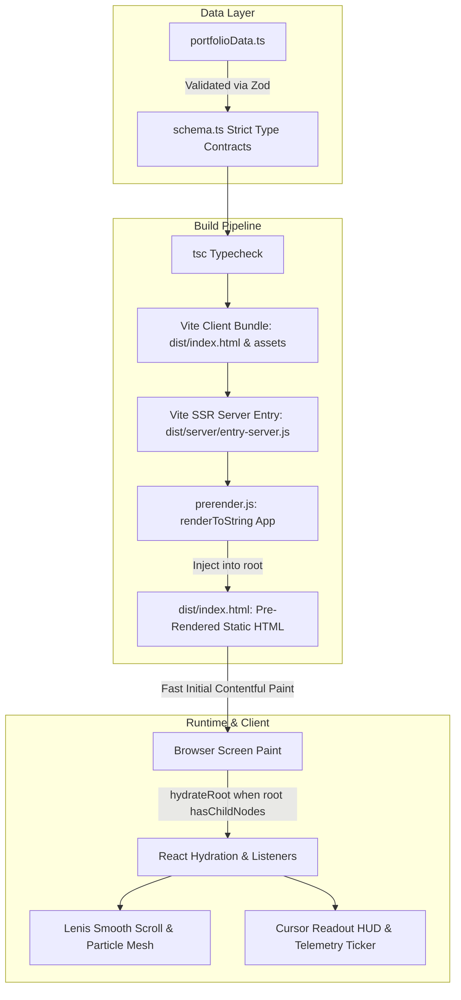

# Umang Khandelwal — AI Engineer & Full-Stack Developer

[](https://github.com/umangkhandelwall/Portfolio/actions)
[](https://umangkhandelwal.vercel.app/)
[](https://www.typescriptlang.org/)
[](https://react.dev/)
[](https://tailwindcss.com/)
[](https://opensource.org/licenses/MIT)

A personal portfolio showcasing full-stack web platforms, AI coding agent benchmarking testbeds, and RAG retrieval pipelines. Built with static pre-rendering (SSG), Zod schema verification, real-time telemetry HUD, and strict dark-mode titanium aesthetic.

🔗 **Live Production URL**: [https://umangkhandelwal.vercel.app/](https://umangkhandelwal.vercel.app/)  
📄 **Machine-Readable AI Context**: [https://umangkhandelwal.vercel.app/llms.txt](https://umangkhandelwal.vercel.app/llms.txt)

---

## 🏗️ Architecture & Static Pre-Rendering (SSG)



---

## 📊 Projects

| Project | Core Stack | Factual Architecture & Scope | Code & Links |
| :--- | :--- | :--- | :--- |
| **Stay Finder** | Next.js (App Router), TypeScript, PostgreSQL, Prisma, Tailwind | Dynamic listings [TODO: need from user: listing count] with atomic reservation transactions and role-based access control [TODO: need from user: latency & Lighthouse score] | [GitHub Repo](https://github.com/umangkhandelwall/StayFinder) |
| **Ink & Insights** | Next.js, PostgreSQL, Prisma, Redis, Google Gemini API | Blog publishing platform featuring Redis sliding-window rate limiting to manage AI quotas and automated editorial critique [TODO: need from user: user count, uptime & latency] | [GitHub Repo](https://github.com/umangkhandelwall/Ink-Insights) |
| **GCC Intel** | Next.js, TypeScript, Tailwind CSS, Data Analytics | Market intelligence dashboard evaluating India's GCC ecosystem [TODO: need from user: GCC count] with comparative metro cost modeling and state policy breakdown | [GitHub Repo](https://github.com/umangkhandelwall/gccintel) |
| **LLM Smart Screen Recorder** | Python, OpenCV, Tesseract OCR, ChromaDB, Gemini RAG | Asynchronous video frame capture with Tesseract OCR, dense vector embedding search, and timestamped citations [TODO: need from user: token count & search latency] | [GitHub Profile](https://github.com/umangkhandelwall) |
| **Agent Benchmarking Suite** | Docker, Python, Bash, Linux | Standardized benchmark suites for autonomous coding agents with isolated Docker testbeds and deterministic verification scripts [TODO: need from user: task count] | [GitHub Profile](https://github.com/umangkhandelwall) |

---

## 💼 Professional Experience

### **Advanced AI Engineer** — Crossing Hurdles *(Jul 2026 – Present · Remote)*
- Author standardized benchmark tasks evaluating AI coding models on real-world system debugging and refactoring.
- Architect deterministic verifiers and sealed Docker evaluation containers to ensure repeatable evaluation runs.
- Construct reference solutions and automated scoring harnesses.

### **LLM Trainer** — Handshake AI *(Jun 2026 – Aug 2026 · Remote)*
- Authored software engineering benchmark tasks [TODO: need from user: task count] testing terminal workflows, dependency migrations, and bug localization.
- Developed reproducible Docker test environments with system-level harness scripts and oracle test suites.
- Validated task correctness through deterministic multi-step verification scripts.

---

## 🔍 SEO & Discoverability Stack

- **Static Pre-rendering**: Raw initial HTML returns complete section text before client JavaScript execution.
- **Robots & Sitemap**: `public/robots.txt` and `public/sitemap.xml` configured with canonical root URL.
- **LLM Search Friendly**: `public/llms.txt` structured machine-readable format.
- **Structured Data**: `application/ld+json` Person, WebSite, and ProfilePage schema graph in `index.html`.
- **Absolute Social Graph**: Open Graph and Twitter Card tags with absolute URLs (`https://umangkhandelwal.vercel.app/umang-portrait.jpg`).

---

## ⚡ Motion & Telemetry Layer

- **Cursor Readout HUD**: Real-time pointer telemetry `[X: 1240, Y: 0450]`, scroll percentage, and system status indicator (respects `prefers-reduced-motion`).
- **Telemetry Status Ticker**: Continuous horizontal marquee showcasing active disciplines and system capabilities.
- **Hardware-Accelerated Canvas**: Pointer-reactive particle mesh and ambient grid lighting.
- **Lenis Smooth Scroll**: Fluid page scrolling with zero jank.
- **Scramble Text Decryption**: High-frequency cipher decryptions initializing cleanly in SSR without DOM flash.

---

## 🛠️ Local Development & Build

### Prerequisites
- Node.js >= 18.0.0
- npm >= 9.0.0

### Quick Start
```bash
# 1. Clone repository
git clone https://github.com/umangkhandelwall/Portfolio.git
cd Portfolio

# 2. Install dependencies
npm install

# 3. Start local development server
npm run dev

# 4. Run TypeScript typecheck & SSG pre-render build
npm run build

# 5. Preview the pre-rendered production build
npm run preview
```

---

## 📄 License
Released under the [MIT License](LICENSE). Copyright © 2026 Umang Khandelwal.
