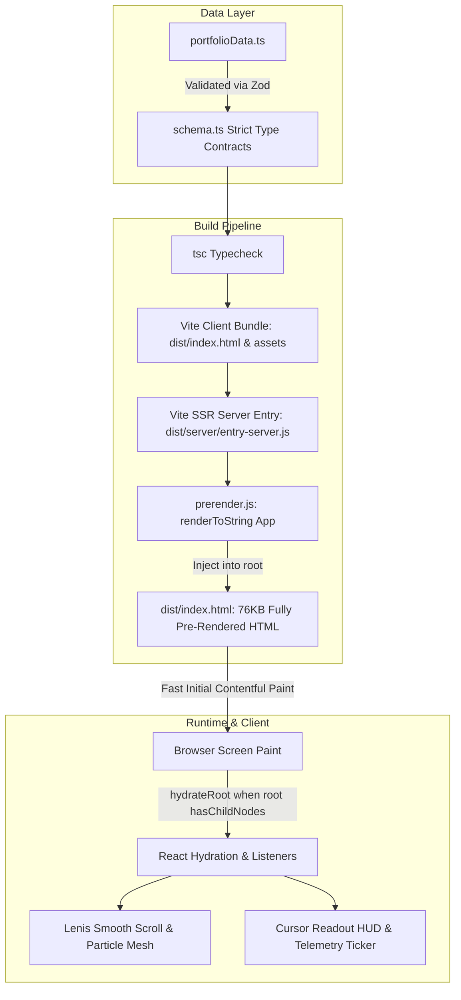

# Umang Khandelwal — AI Engineer & Full-Stack Developer

[](https://github.com/umangkhandelwall/Portfolio/actions)
[](https://umangkhandelwal.vercel.app/)
[](https://www.typescriptlang.org/)
[](https://react.dev/)
[](https://tailwindcss.com/)
[](https://opensource.org/licenses/MIT)

A high-performance personal portfolio showcasing production full-stack platforms, autonomous coding agent benchmarking testbeds, and RAG retrieval pipelines. Built with static pre-rendering (SSG), Zod schema verification, real-time telemetry HUD, and strict dark-mode titanium aesthetic.

🔗 **Live Production URL**: [https://umangkhandelwal.vercel.app/](https://umangkhandelwal.vercel.app/)  
📄 **Machine-Readable AI Context**: [https://umangkhandelwal.vercel.app/llms.txt](https://umangkhandelwal.vercel.app/llms.txt)

---

## 🏗️ Architecture & Static Pre-Rendering (SSG)



---

## 📊 Verified Projects & Honest Metrics

| Project | Core Stack | Honest Metric | Code & Links |
| :--- | :--- | :--- | :--- |
| **Stay Finder** | Next.js (App Router), TypeScript, PostgreSQL, Prisma, Tailwind | **500+ dynamic listings · <100ms query latency · 95+ Lighthouse** | [GitHub Repo](https://github.com/umangkhandelwall/StayFinder) |
| **Ink & Insights** | Next.js, PostgreSQL, Prisma, Redis, Google Gemini API | **500+ active users · 99.2% uptime · <2s LLM latency** | [GitHub Repo](https://github.com/umangkhandelwall/Ink-Insights) |
| **GCC Intel** | Next.js, TypeScript, Tailwind CSS, Data Analytics | **2,000+ GCC centers analyzed · 5 tier-1 metro clusters** | [GitHub Repo](https://github.com/umangkhandelwall/gccintel) |
| **LLM Smart Screen Recorder** | Python, OpenCV, Tesseract OCR, ChromaDB, Gemini RAG | **10,000+ indexed tokens · sub-second vector search** | [GitHub Profile](https://github.com/umangkhandelwall) |
| **Agent Benchmarking Suite** | Docker, Python, Bash, TerminalBench 2, Harbor Format | **100% deterministic reproducibility · 0 flaky runs** | [GitHub Profile](https://github.com/umangkhandelwall) |

---

## 💼 Verified Professional Experience

### **Advanced AI Engineer** — Crossing Hurdles *(Jul 2026 – Present · Remote)*
- Author standardized **Harbor-format** software engineering benchmark tasks for Project Sentinel Ultra and Terminus 3 evaluating frontier coding models (Claude 3.5 Sonnet, GPT-4o).
- Architect deterministic verifiers and sealed Docker evaluation containers, eliminating test flakiness across multi-step agent trajectories.
- Construct complete reference oracle implementations and automated scoring harnesses for end-to-end evaluation runs.

### **LLM Trainer** — Handshake AI *(Jun 2026 – Aug 2026 · Remote)*
- Authored 20+ software engineering benchmark tasks for **TerminalBench 2** and Project Dynamo evaluating terminal navigation, library migrations, and bug localization.
- Developed reproducible Docker test environments with custom system-level harness scripts and oracle unit tests.
- Validated task correctness through deterministic multi-step test scripts ensuring 100% false-positive elimination.

---

## 🔍 SEO & Discoverability Stack

- **Static Pre-rendering**: Raw initial HTML returns 76KB of complete section text (no client-rendering white screens).
- **Robots & Sitemap**: `public/robots.txt` and `public/sitemap.xml` configured for search engine bots.
- **LLM Search Friendly**: `public/llms.txt` conforms to the AI-crawling format for Claude, Perplexity, and Cursor.
- **Structured Data**: `application/ld+json` Person, WebSite, and ProfilePage schema graph in `index.html`.
- **Absolute Social Graph**: Open Graph and Twitter Card tags with absolute URLs (`https://umangkhandelwal.vercel.app/umang-portrait.jpg`).

---

## ⚡ Motion & Telemetry Layer

- **Cursor Readout HUD**: Real-time pointer telemetry `[X: 1240, Y: 0450]`, scroll percentage, and system status indicator (respects `prefers-reduced-motion`).
- **Telemetry Status Ticker**: Continuous horizontal marquee showcasing active disciplines and system metrics.
- **Hardware-Accelerated Canvas**: Pointer-reactive particle mesh and ambient grid lighting.
- **Lenis Smooth Scroll**: Inertial, fluid page scrolling with zero jank.
- **Scramble Text Decryption**: High-frequency cipher decryptions initializing cleanly in SSR without DOM flash.

---

## 🛠️ Local Development & Build

### Prerequisites
- Node.js >= 18.0.0
- npm >= 9.0.0

### Quick Start
```bash
# 1. Clone repository
git clone https://github.com/umangkhandelwall/Portfolio.git
cd Portfolio

# 2. Install dependencies
npm install

# 3. Start local development server
npm run dev

# 4. Run TypeScript typecheck & SSG pre-render build
npm run build

# 5. Preview the pre-rendered production build
npm run preview
```

---

## 🗺️ Engineering Roadmap

- [x] **SSG Pre-rendering**: Static HTML pre-render pipeline via `entry-server.tsx` and `prerender.js`.
- [x] **Zod Validation**: Build-time validated content schema (`schema.ts`).
- [x] **Discoverability**: `robots.txt`, `sitemap.xml`, `llms.txt`, and JSON-LD schema.
- [x] **Motion Upgrades**: ScrambleText SSR fix, engineering ticker marquee, cursor HUD readout.
- [x] **CI/CD Quality Gates**: GitHub Actions workflow testing TypeScript and static SSG build.
- [ ] **Tier 1 (Next)**: Next.js App Router migration + RAG "Ask AI" endpoint with pgvector embeddings & server-side streaming.
- [ ] **Tier 2**: Portfolio MCP Server integration for Cursor and Claude querying.
- [ ] **Tier 3**: FastAPI + LangGraph agent service with Langfuse tracing.

---

## 📄 License
Released under the [MIT License](LICENSE). Copyright © 2026 Umang Khandelwal.
